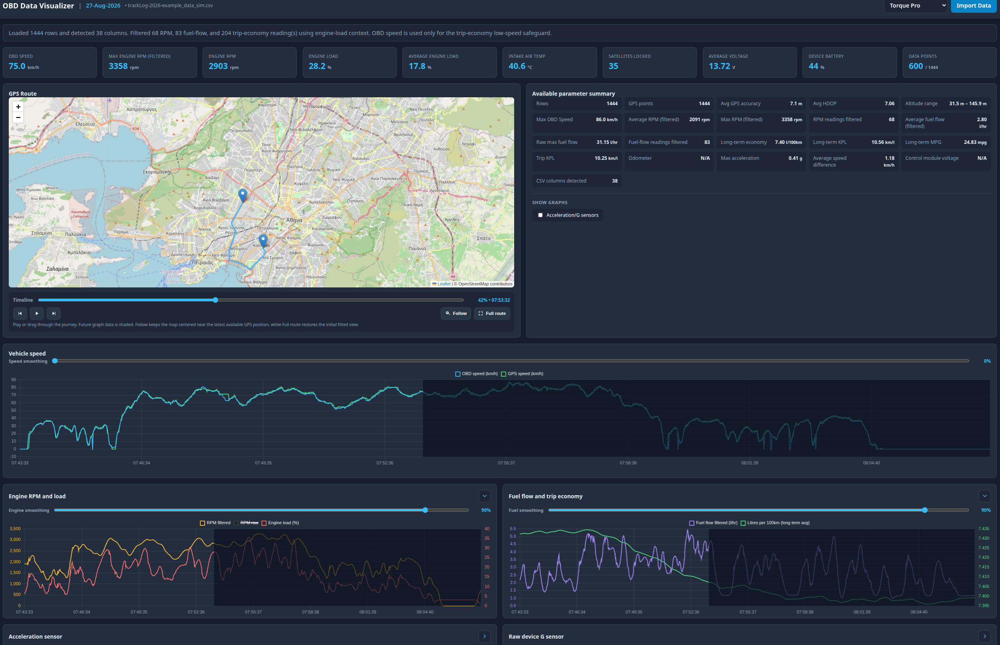

# obd-visualizer
torque pro / OBD data visualizer





Following is a list of most of the items that are being tracked currently, it is advisable you at least select/enable some of these:

_Torque > Settings > Data Logging & Upload > Select what to log_
<br><br>

* Acceleratio sensors, device G sensors
* Android device Battery Level
* Engine Load
* Engine RPM
* Engine Temp*
* Fuel flow rate/hour

_GPS data if  you want to use the map - Screen on & Torque window active, until Torque Pro gets android api update_
* GPS Accuracy
* GPS Altitude
* GPS Latitude
* GPS Longitude
* GPS Satellites

* Intake Air Temperature
* Kilometers Per Litre(Long Term Average)
* Litres Per 100 Kilometer(Long Term Average)
* Miles Per Gallon(Long Term Average)
* Odometer
* Speed (OBD)
* Speed (GPS)
* Voltage (OBD Adapter)  
  
<br><br>
If you use additional sensors, PIDs or data points, open issue and request and it will be added.
<br>

Currently supports Torque Pro, will support Car Scanner ELM at a later date.  
<br>
_It seems that some combinations of car/OBD adaptors work fine for every other PID, but the engine temperature PID is always returned with one byte missing or corrupted. This can be fixed in Torque Pro by creating a custom PID that skips the corrupt byte (In settings go to "Manage Extra PIDS" / "Add custom PID") as follows:_

```PID: 0105
Name: Engine Temp
Minimum Value: 0
Maximum Value: 130
Scale Factor: x1
Unit Type: ºC
Equation: R1-40

